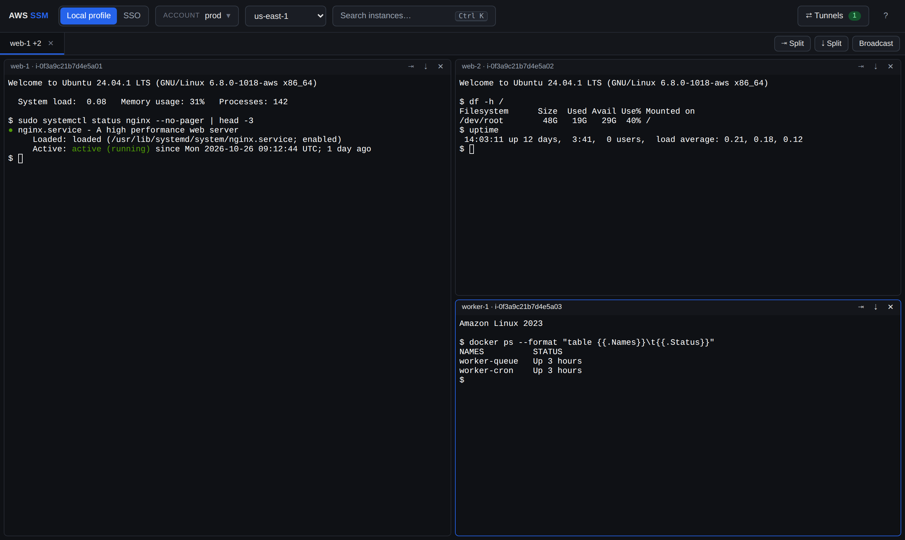
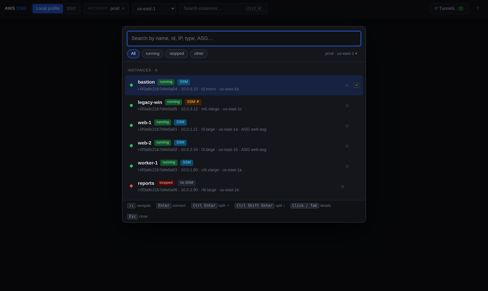
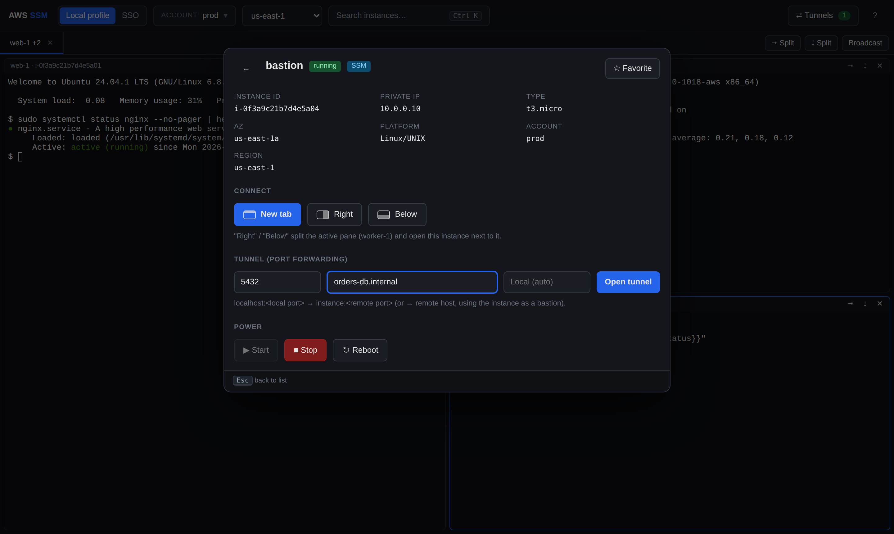

# aws-ssm-web

A local web UI for **AWS Systems Manager Session Manager**: find EC2 instances across your AWS
profiles (or SAML SSO roles) and open SSM shells in a multi-pane, Terminator-style terminal right in
the browser, with no SSH keys, bastions or open inbound ports.

It is a thin layer over the tools you already have (`aws` CLI v2 + `session-manager-plugin`) and runs
only on `127.0.0.1`.



| Search instances (`Ctrl K`) | Instance details: connect, tunnel, power |
|---|---|
|  |  |

## Features

- **Command palette (`Ctrl K`)**: search instances by name, id, IP, type, AZ or ASG, ranked by
  relevance (name matches weigh more). `running` instances first, filter chips by state. `Enter`
  connects, `Ctrl Enter` / `Ctrl Shift Enter` open it in a split, click or `Tab` opens the details.
- **Multi-pane terminals**: tabs that split right / below like Terminator, draggable dividers,
  keyboard navigation between panes, and **broadcast** mode (type into every pane of a tab at once).
- **SSM agent status** per instance (`SSM`, `SSM ✗`, `no SSM`), so you know before connecting
  whether the session will work.
- **Port forwarding tunnels**: `localhost:<port>` → a port on the instance
  (`AWS-StartPortForwardingSession`), or → any host the instance can reach, e.g. an RDS endpoint
  (`AWS-StartPortForwardingSessionToRemoteHost`), using the instance as a bastion.
- **Start / stop / reboot** instances with a confirmation that shows the account and region (and warns
  if the instance belongs to an Auto Scaling group), then follows the state until it settles.
- **Favorites and recents**, also on the home screen: one click reopens a session without listing again.
- **Two ways to authenticate**:
  - **Local profiles** from `~/.aws/config` / `~/.aws/credentials`, including IAM Identity Center
    (`aws sso login`) and static / assume-role profiles.
  - **SAML SSO** with any SAML 2.0 IdP federated to AWS (Entra ID, Okta, Keycloak, Google
    Workspace, ...): you sign in in a dedicated browser window, the app intercepts the
    `SAMLResponse` and calls `sts:assume-role-with-saml`, so no long-lived IAM credentials are needed.

## Requirements

- Node.js 20+ and [pnpm](https://pnpm.io) (`corepack enable`)
- [AWS CLI v2](https://docs.aws.amazon.com/cli/latest/userguide/getting-started-install.html) and the
  [Session Manager plugin](https://docs.aws.amazon.com/systems-manager/latest/userguide/session-manager-working-with-install-plugin.html)
- For SAML SSO mode only: a Chromium-based browser (Chrome, Edge or Chromium)
- Instances need the SSM agent running, an instance profile with `AmazonSSMManagedInstanceCore`
  (or equivalent), and outbound access to the SSM endpoints

## Quick start

### On the host

```bash
corepack enable
pnpm install
pnpm start
```

Open <http://127.0.0.1:4177>.

### Docker (local profiles only)

```bash
docker compose up -d --build
```

`~/.aws` is mounted read-only, except `~/.aws/sso` (the IAM Identity Center token cache), which is
shared read-write so an `aws sso login` on the host is picked up immediately. The UI is published on
`127.0.0.1:4177` and tunnels on `127.0.0.1:15000-15019`.

SAML SSO mode opens a real browser window, so it needs to run on the host, not in the container.

## SAML SSO setup

Set `SSO_LOGIN_URL` to the **IdP-initiated sign-in URL** of the AWS SAML application in your identity
provider, i.e. the URL that, opened in a browser, signs you in and lands on the AWS console role
picker:

| IdP | Where to find it | Typical shape |
|---|---|---|
| Microsoft Entra ID | Enterprise application (AWS) → Properties → *User access URL* | `https://launcher.myapps.microsoft.com/api/signin/<app-id>?tenantId=<tenant-id>` |
| Okta | AWS app → General → *App Embed Link* | `https://<org>.okta.com/home/amazon_aws/<app-id>/272` |
| Keycloak | SAML client → *IDP-Initiated SSO URL name* | `https://<host>/realms/<realm>/protocol/saml/clients/<url-name>` |
| Google Workspace | SAML app → *Test SAML login* URL | `https://accounts.google.com/o/saml2/initsso?idpid=<idp-id>&spid=<sp-id>` |

```bash
SSO_LOGIN_URL='https://...' pnpm start
```

Then switch to **SSO** in the top bar and sign in. The first time you'll do your full IdP login
(MFA included) in a dedicated browser profile (`.browser-profile/`, gitignored) that never touches
your regular browser; after that the IdP session is reused while it's valid.

Optionally, map account ids to friendly names in the role picker by copying
`accounts-map.example.json` to `accounts-map.json` (gitignored) or pointing `ACCOUNTS_MAP_FILE` at
your own file.

## Keyboard shortcuts

| Shortcut | Action |
|---|---|
| `Ctrl K` (`Ctrl Shift K` from a terminal) | Open the instance search |
| `↑` `↓`, `Enter` | Navigate, connect in a new tab (opens the details if not running) |
| `Ctrl Enter` / `Ctrl Shift Enter` | Connect in a split to the right / below the active pane |
| Click / `Tab` | Instance details: connect, tunnel, start / stop / reboot, favorite |
| `Ctrl Shift E` / `Ctrl Shift O` | Duplicate the active pane to the right / below |
| `Ctrl Shift X` | Close the pane |
| `Alt ←↑→↓` | Move between panes |
| `Ctrl Shift B` | Toggle broadcast for the tab |
| `Esc` | Back / close |

Dividers can be dragged; double-click resets them to 50/50.

## IAM permissions

The profile or role you use needs, depending on the features:

- `ec2:DescribeInstances`: list instances
- `ssm:StartSession` and `ssm:TerminateSession`: shells and tunnels (default shell document, plus
  `AWS-StartPortForwardingSession` / `AWS-StartPortForwardingSessionToRemoteHost` for tunnels)
- `ssm:DescribeInstanceInformation`: SSM agent badges (optional; hidden without it)
- `ec2:StartInstances`, `ec2:StopInstances`, `ec2:RebootInstances`: power actions (optional)

## Configuration

| Variable | Default | Purpose |
|---|---|---|
| `PORT` | `4177` | Server port |
| `HOST` | `127.0.0.1` | Bind interface (`0.0.0.0` only inside Docker, published on loopback) |
| `TUNNEL_PORT_RANGE` | `15000-15099` | Local ports for tunnels (in Docker it must match the ports published in `docker-compose.yml`) |
| `SSO_LOGIN_URL` | — | IdP-initiated sign-in URL for SAML SSO mode |
| `ACCOUNTS_MAP_FILE` | `./accounts-map.json` | Optional account id → name map for the role picker |
| `SSO_BROWSER_PATH` | auto-detected (Edge, Chrome, Chromium) | Browser binary for the SSO login |
| `SSO_BROWSER_USER_DATA_DIR` | `./.browser-profile` | Dedicated browser profile for the SSO login |

## Security

- Binds to `127.0.0.1` only. It has no auth of its own, so never expose it on a network.
- Every HTTP and WebSocket request must come from the app's own origin, so another tab in your browser
  can't drive it against `localhost`. Power actions are `POST`-only.
- SSO credentials (the SAML assertion and the STS credentials) live in process memory only and are
  never written to disk. Local profiles are used through the `aws` CLI as usual.
- The SSO login runs in a separate, dedicated Chromium profile, never in your regular browser.
- Instance names and tags are rendered as text, never as HTML.

## How it works

- `server.js`: Express + WebSocket server. Lists profiles and instances (`aws ec2 describe-instances`
  + `aws ssm describe-instance-information`), runs power actions, and spawns
  `aws ssm start-session` in a pseudo-terminal (`node-pty`) per pane, streamed over a WebSocket.
  Tunnels run `start-session` with the port-forwarding documents behind a small TCP proxy (the plugin
  only binds to loopback, which can't be published from a container).
- `sso.js`: SAML SSO. Drives the browser with `playwright-core`, intercepts the `SAMLResponse` posted
  to `https://signin.aws.amazon.com/saml`, parses the roles and exchanges the assertion with
  `sts:assume-role-with-saml`.
- `public/index.html`: the whole frontend, vanilla JS + [xterm.js](https://xtermjs.org).

## License

[MIT](LICENSE)
